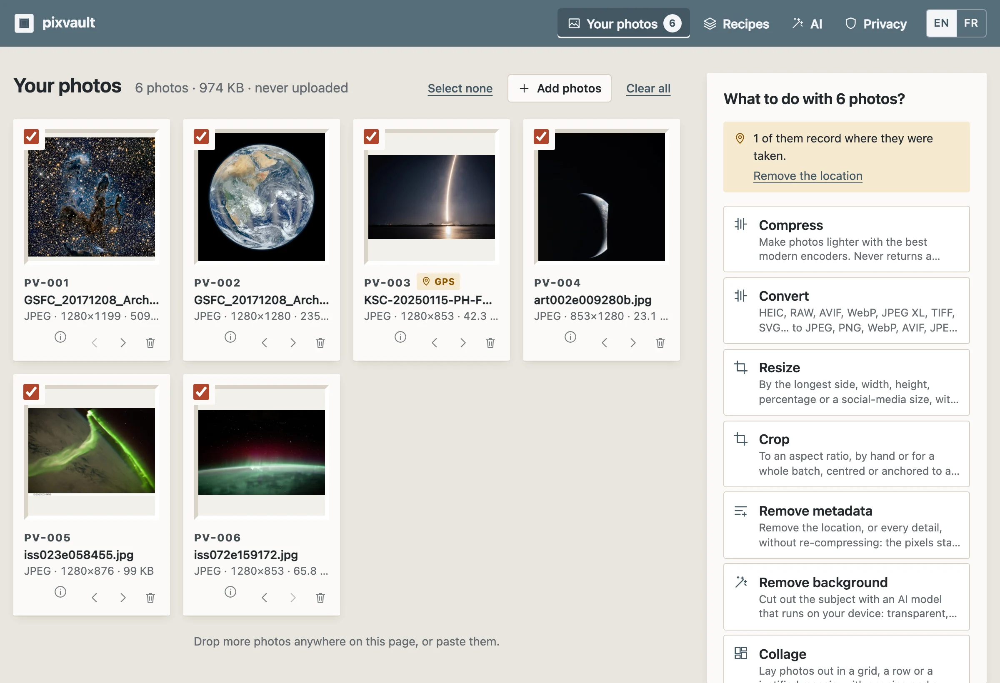
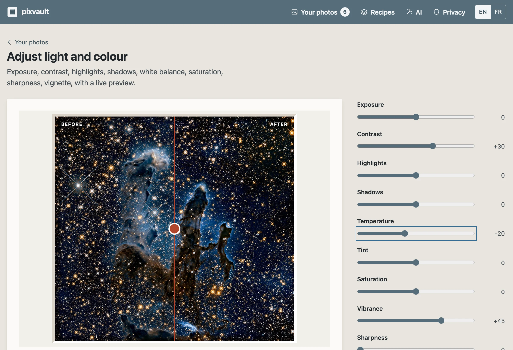

# pixvault

**Private photo tools that never upload your photos.** Compress, convert HEIC and RAW, resize, crop, retouch, watermark, clean the metadata, combine, and edit with AI models that run on your device. One photo or a few hundred at once.

→ [maxgfr.github.io/pixvault](https://maxgfr.github.io/pixvault/) · works offline · English and French

[](https://github.com/maxgfr/pixvault/actions/workflows/ci.yml)
[](https://github.com/maxgfr/pixvault/releases)

<picture>
  <source media="(prefers-color-scheme: dark)" srcset="docs/workspace-dark.webp">
  
</picture>

<picture>
  <source media="(prefers-color-scheme: dark)" srcset="docs/adjust-dark.webp">
  
</picture>

## Why

Online image tools ask you to upload your photos to someone else's server, one task per website: one to shrink, one for HEIC, one to remove the background, one to strip the location. pixvault does all of it in the browser tab, in batches, and nothing leaves the device. The sibling of [pdfvault](https://github.com/maxgfr/pdfvault), which does the same for PDFs.

## How it works

1. Drop photos (or a whole folder, or paste a screenshot, or share them to the installed app from your phone).
2. They appear as a catalogued collection: format, size, dimensions, and a badge when a photo records where it was taken.
3. Pick an action. Every per-photo tool applies to the whole selection; most show a live before/after preview first.
4. Download one file, a ZIP, save straight into a folder, share, or keep working on the results.

Your originals stay untouched until you choose to replace them.

## Tools

| | |
|---|---|
| **Compress and convert** | Compress with MozJPEG, OxiPNG, WebP, AVIF or JPEG XL, to a quality, a maximum size or losslessly, never returning a bigger file; convert between JPEG, PNG, WebP, AVIF, JPEG XL, GIF, TIFF, BMP, ICO, QOI and PDF; reads HEIC/HEIF (iPhone), camera RAW (DNG, CR2, CR3, NEF, ARW, RAF, ORF, RW2…), TIFF and SVG |
| **Resize and crop** | Resize by side, size, percentage or social-media preset (Lanczos); crop to a ratio or by hand, centred, anchored or on the busiest area; rotate, straighten, mirror; square and margins with a blurred background; border, rounded corners, shadow; split into tiles |
| **Adjust and filters** | Exposure, contrast, highlights, shadows, white balance, saturation, vibrance, sharpness, blur, vignette, grain; auto enhance; black and white, sepia, vintage, duotone and more; any `.cube` 3D LUT |
| **Watermark and redact** | Text or logo watermark, in a corner or tiled; captions with the date and camera settings; blur, pixelate or cover the areas you draw |
| **Metadata and names** | See every detail a photo carries and what it gives away; remove the location or everything **without re-compressing**; fix the date or a camera clock in the wrong time zone, set author and copyright; batch rename from a pattern |
| **Combine** | Collage (justified mosaic, grid, row, column), contact sheet (PDF or image), side by side, photos to PDF, animated GIF, GIF frames, sprite sheet with CSS, favicon and app icon set |
| **Analyze** | Colour palette, histogram and exposure, duplicate and near-duplicate finder, data URI |
| **AI on your device** | Remove the background, upscale ×2/×4, blur every face, erase objects, smart crop, describe and tag (alt text, captions, keywords written into the file or used to rename it) |
| **Recipes** | Chain steps (resize → watermark → WebP without location…), save them, share them as a link |

### AI models

Every model is open, downloaded once only when you first use its tool, checked against its pinned SHA-256, and kept in your browser until you remove it (AI page).

| Tool | Model | Licence | Size | Served from |
|---|---|---|---|---|
| Remove background | [BiRefNet lite](https://github.com/ZhengPeng7/BiRefNet) (with WebGPU) | MIT | 115 MB | Hugging Face |
| Remove background | [MODNet](https://github.com/ZHKKKe/MODNet) (without WebGPU, best on people) | Apache-2.0 | 7 MB | this site |
| Upscale ×2 / ×4 | [Swin2SR](https://github.com/mv-lab/swin2sr) | Apache-2.0 | 19 MB each | this site |
| Blur faces, smart crop | [YuNet](https://github.com/opencv/opencv_zoo) | MIT | 0.2 MB | this site |
| Erase objects | [MI-GAN](https://github.com/Picsart-AI-Research/MI-GAN) | MIT | 28 MB | this site |
| Describe and tag | [Florence-2 base](https://huggingface.co/microsoft/Florence-2-base-ft) | MIT | 218 MB | Hugging Face |

They run with ONNX Runtime Web on the graphics card when the browser has WebGPU, on the processor otherwise (slower). **Describe and tag** can also use your own AI provider (OpenAI, Anthropic, Google, Mistral, OpenRouter, Groq, xAI, or a local Ollama / LM Studio) through [llm-connect](https://github.com/maxgfr/llm-models): the key is encrypted in your browser, and only the photos you describe are sent, reduced to 1024 px.

## How privacy is enforced

- **Content Security Policy**: scripts only from the site, `connect-src` limited to the site, the model hosts and the AI providers listed above, Trusted Types for every script URL, no frames.
- **No-network gate in CI**: the build fails if any shipped file contains an outside address that is not allowlisted with a written reason, or a network call to a literal URL (`scripts/check-no-network.ts`).
- **End-to-end tests** fail on any request to another origin, any CSP violation and any page error.
- **Build provenance**: the deployed files carry a signed attestation (`gh attestation verify <file> -R maxgfr/pixvault`).

## Architecture

- **Engine** (`src/engine/`, TypeScript, runs in a pool of Web Workers): codecs from [jSquash](https://github.com/jamsinclair/jSquash) (MozJPEG, libwebp, libavif, libjxl, OxiPNG, QOI, resize), [libheif](https://github.com/catdad-experiments/libheif-js), [UTIF](https://github.com/photopea/UTIF.js), RAW through the camera's embedded preview, lossless metadata surgery on JPEG/PNG/WebP segments and in-place scrubbing for HEIC/AVIF/TIFF/RAW, pixel operations on one RGBA raster type, ONNX Runtime Web for the models.
- **Tool catalog** (`src/tools/`): one bilingual list of tools and their fields; the interface renders forms from it, the worker looks implementations up by id.
- **Interface** (`src/`, React 19, hand-written CSS): designed as a museum print room — each photo in a bevel-cut mat with an accession number, archival-box blue-grey shell, one conservation red for the action about to run.
- **Build** (`scripts/build.ts`): Bun bundles the app and the worker, copies the wasm and the self-hosted models, and writes an offline service worker with a hashed manifest.

## Development

```bash
bun install
bun run fetch-models   # the self-hosted AI models, pinned by SHA-256, into models/
bun run dev            # build and serve on http://localhost:4173/pixvault/
bun run typecheck
bun run lint
bun run test           # engine unit tests, including the self-hosted models
bun run build && bun run check:network
bun run e2e            # Playwright end to end
bun run catalog        # refresh public/models.json (AI providers with vision models)
```

## Limits

- RAW files are read through the full-size JPEG preview the camera embeds, not by developing the sensor data.
- Re-encoded photos keep their details in JPEG, PNG and WebP; AVIF and JPEG XL outputs carry none. Colours are converted to sRGB.
- Images over 160 megapixels are refused: a browser tab does not have the memory.
- GitHub Pages cannot make the page cross-origin isolated, so codecs and models run single-threaded per worker; several photos are processed in parallel instead. Without WebGPU, upscaling and captions take minutes.

## Credits

jSquash and Squoosh (Apache-2.0), libheif (LGPL-3.0), UTIF (MIT), exifr (MIT), gifenc and omggif (MIT), pdf-lib (MIT), fflate (MIT), ONNX Runtime Web (MIT), Transformers.js (Apache-2.0), the AI SDK (Apache-2.0), llm-connect (MIT), React (MIT), and the models above.

## License

MIT
